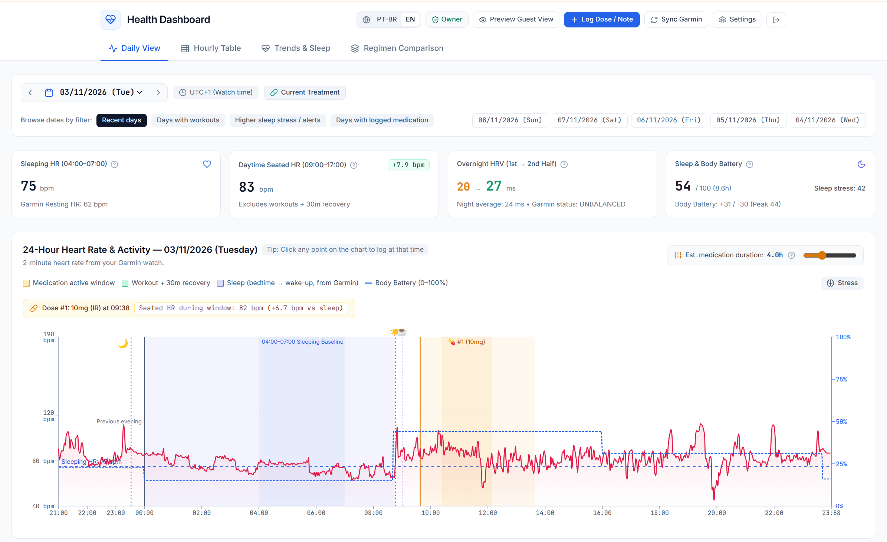
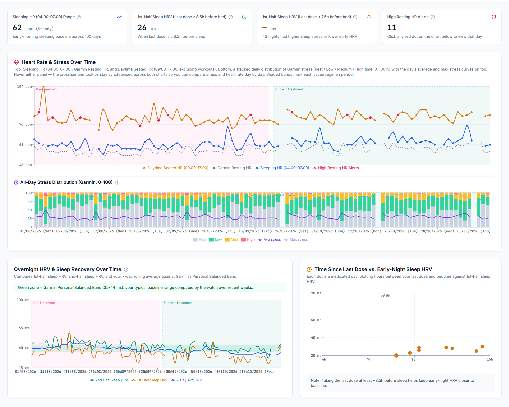

# garmin-rx: A Health & Biometrics Dashboard


A webapp that fuses data from the [Garmin Connect Personal API](https://developer.garmin.com/gc-developer-program/personal/personal-api),
and user entries regarding caffeine and medication doses. This is intended to help analyze the
impact of medications on the heart and sleep quality of the user. 

**garmin-rx provides**
- a fully serverless architecture with firebase
- synchronization with the Garmin API on a schedule
- visualizations of heart rate, sleep, configurable action windows of medications 
- long term trends using heart rate variability data (HRV), stress indicators, and resting heart rate 
- sharing with other gmail accounts that you choose


This software is provided as is, without any warranty or liability.

---

## Overview & Screenshots

### Daily Telemetry & Intake Timeline
High-resolution 2-minute heart rate telemetry synchronized with medication intake windows, automated workout recovery exclusion, sleep stages, and real-time Body Battery tracking.


### Longitudinal Trends & Treatment Analysis
Long-term biometric analysis comparing pre-treatment vs. current treatment regimens, daytime seated heart rate baselines, all-day stress distribution, overnight HRV recovery (1st vs. 2nd half of sleep), and bedtime dose proximity impact.



---

## Running Locally

### 1. Prerequisites
- **[Bun](https://bun.sh/)** (recommended runtime & package manager for web and functions)
- **[uv](https://github.com/astral-sh/uv)** or Python 3.12+ (for data collection and analysis CLI tools)
- **Garmin Personal API Key** (optional, to fetch live Garmin biometrics; generate at [Garmin Connect Settings](https://connect.garmin.com/app/settings/personalApiToken))

### 2. Environment Configuration

Copy the example environment files:

```bash
# Python & backend scripts configuration
cp .env.example .env

# React web app configuration
cp web/.env.example web/.env.local
```

Fill in `web/.env.local` with your Firebase project credentials (API Key, Auth Domain, Project ID, etc.).

### 3. Install Dependencies

```bash
# Web frontend dependencies
bun install --cwd web

# Cloud Functions dependencies
bun install --cwd functions

# Python dependencies (for CLI tools)
uv sync
```

### 4. Start the Web Dashboard

```bash
bun run --cwd web dev
```
The dashboard will be available at `http://localhost:5173`.

### 5. Fetch & Analyze Garmin Biometrics (CLI)

```bash
# Download daily Garmin biometrics (resumes automatically if interrupted)
uv run python fetch_biometrics.py --start 2024-01-01

# Run statistical analysis on downloaded data
uv run python analyze_biometrics.py
```

### 6. Run Cloud Functions Locally (Optional)

```bash
# Build functions in watch mode
bun run --cwd functions build:watch

# Start Firebase Emulators for functions
firebase emulators:start --only functions
```

---

## Deploying to Firebase

### 1. Prerequisites
Install the Firebase CLI and log in:

```bash
# Install Firebase CLI (via Bun or npm)
bun add -g firebase-tools
# or: npm install -g firebase-tools

# Log in to your Firebase account
firebase login
```

### 2. Configure Firebase Project

Set your Firebase project ID by copying the example `.firebaserc` or using the CLI:

```bash
cp .firebaserc.example .firebaserc
# Edit .firebaserc with your project ID, or run:
firebase use <your-firebase-project-id>
```

### 3. Configure Cloud Functions Secrets

If deploying the automated Garmin synchronization Cloud Functions, set your Garmin API secret in Firebase:

```bash
firebase functions:secrets:set GARMIN_PERSONAL_API_KEY
```

### 4. Deploy

Deploy everything or choose individual targets:

| Target | Command | Notes |
|---|---|---|
| **Everything** | `firebase deploy` | Deploys Hosting, Functions, and Firestore |
| **Hosting (Web & PWA)** | `firebase deploy --only hosting` | Builds and publishes React app to Firebase Hosting |
| **Cloud Functions** | `firebase deploy --only functions` | Compiles TypeScript and deploys 2nd Gen Functions |
| **Firestore Rules & Indexes** | `firebase deploy --only firestore` | Updates `firestore.rules` and `firestore.indexes.json` |

> [!NOTE]
> `firebase deploy` automatically executes the `predeploy` build hooks defined in `firebase.json` (`bun run --cwd web build` and `bun run --cwd functions build`). Make sure `bun install` has been run before deploying.

### 5. Seed Historical Data

To seed your Firestore database with historical data from `data/processed_seed.json`:

```bash
# Uses the active Firebase CLI OAuth session
python seed_firestore_cli.py
```
